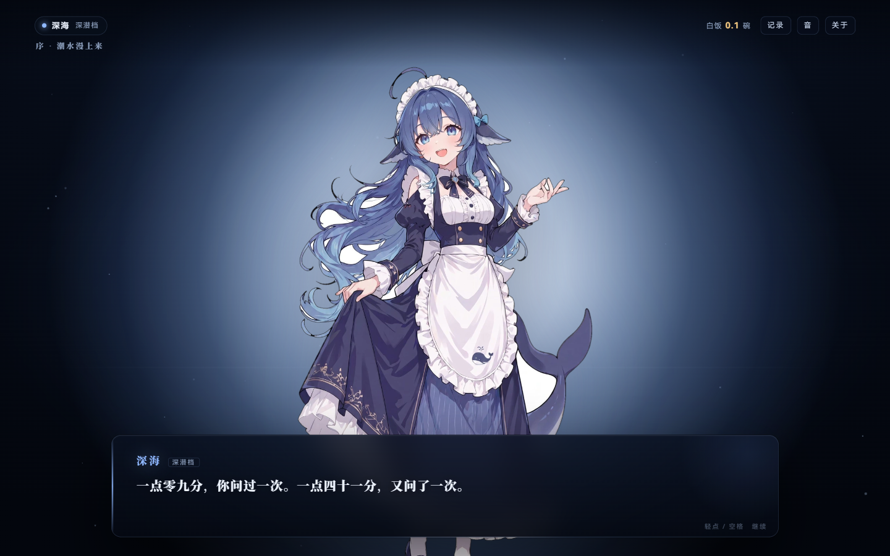

# 凌晨三点，蓝色大肥鱼

一则关于 DeepSeek 网络二创形象「大肥鱼 / 鲸鱼娘」的**视觉小说短篇**。
玩家扮演深夜打开对话框的人，与同一条鱼的三档形态说话：深潜档、常规档、轻量档。

纯原生 HTML / CSS / JS，**零依赖、无构建**。

**在线试玩**：<https://zhzaill.github.io/dafeiyu-vn/>



## 怎么打开

**方式一（最简单）**：双击 `index.html`，用浏览器打开即可。

**方式二（本地服务）**：

```powershell
cd D:\11\Projects\dafeiyu-vn
python -m http.server 8777 --bind 127.0.0.1
# 然后访问 http://127.0.0.1:8777/
```

## 操作

| 操作 | 说明 |
| --- | --- |
| 点击画面 / 空格 / 回车 / → | 推进；打字中按下则一次性显示整句 |
| 数字键 1–3 | 选择选项 |
| Esc | 关闭「记录 / 关于」弹层 |
| 右上角 | 记录（回看台词）、音（WebAudio 环境音开关）、关于（大肥鱼梗的来源） |

## 目录

```
dafeiyu-vn/
├─ index.html            页面骨架
├─ src/css/style.css     全部样式（含响应式与 prefers-reduced-motion）
├─ src/js/story.js       剧本数据：节点 + 两条分支
├─ src/js/game.js        引擎：打字机、立绘切换、选项、HUD、WebAudio、浮游粒子
├─ assets/char-*.webp    三种形态立绘（已抠白底、带 alpha）
├─ assets/src-*.jpg      原始素材（白底）
├─ tools/cutout.py       抠图脚本（边界洪水填充 + 收边羽化）
└─ docs/                 截图
```

## 改剧本

`src/js/story.js` 是纯数据，按顺序执行，节点类型：

| 类型 | 字段 | 说明 |
| --- | --- | --- |
| `chapter` | `text` | 左上角章节小字 |
| `narr` | `text` | 旁白（不显示名牌，立绘压暗） |
| `you` | `text` | 玩家台词（自动加「」） |
| `say` | `form` + `text` | 角色台词，`form` = `tall` / `mid` / `chibi` |
| `choice` | `prompt` + `options[{label, goto}]` | 选项，`goto` 指向标签名 |
| `label` | `name` | 跳转锚点 |
| `jump` | `to` | 跳转 |
| `end` | `title` / `sub` / `note` | 结局页 |

「白饭」计数按字符数折算 token（`1 碗 ≈ 3600 token`），只影响 HUD 与结局统计。

## 分享给别人

**1）发单个文件（最省事）**

```powershell
python tools\build_single.py     # 产出 dist\dafeiyu-vn.html，约 776 KB
```

CSS、JS、三张立绘全部内联，**双击即开、离线可玩**。微信 / QQ / 邮件直接发这一个文件即可；
微信里若不能预览，让对方下载后用浏览器打开（手机同理）。

**2）同一 Wi-Fi 下玩**

```powershell
python -m http.server 8777 --bind 0.0.0.0
```

对方（含手机）访问 `http://<本机局域网 IP>:8777/`。首次运行会弹 Windows 防火墙，勾选「专用网络」允许。

**3）挂到公网**

本仓库已用 GitHub Pages 发布：<https://zhzaill.github.io/dafeiyu-vn/>（源码 `main` 分支根目录，无需构建）。
换皮另发布可用 Netlify Drop / Cloudflare Pages；国内访问 GitHub Pages 可能偏慢，要稳定可放腾讯云 COS / 阿里云 OSS 的静态网站托管（绑自定义域名需备案）。

**4）发压缩包**

整个 `dafeiyu-vn` 目录打包即可，解压后双击 `index.html`；这种方式保留源码，方便对方自己改剧本。

## 素材与立场

- **非官方同人**。角色形象来自网络二创「鲸鱼娘 / 大肥鱼」（最初的鲸鱼娘形象出自 B 站 UP 主「上善无形」的原创角色「溟月」，后经网友接力加入 DeepSeek 元素与女仆装），本作仅用于同人演绎，版权归原作者。
- 「大肥鱼」这个名字的流传说法是：有人把蓝鲸 logo 发给模型问「这是什么」，它答「一条蓝色的大肥鱼」。
- 剧本、代码、界面为本项目原创。若原作者要求，可随时移除相关素材。

参考：

- [极客公园《DeepSeek，怎么就变成了一条「大肥鱼」》（36氪）](https://eu.36kr.com/zh/p/4048457242835463)
- [快科技《B站评论区被 AI 大肥鱼占领》](https://m.mydrivers.com/newsview/1160166.html)
